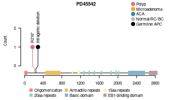

## Setup


``` r
suppressPackageStartupMessages({
  library(trackViewer)
  library(GenomicRanges)
  library(grid)
})
```


``` r
## Figure geometry -----------------------------------------------------------
REF_WIDTH  <- 7.2                 # width of the established plot (in)
REF_HEIGHT <- 4.2                 # height of the established plot (in)
FIG_WIDTH  <- 89 / 25.4           # Nature single column = 89 mm
SCALE      <- FIG_WIDTH / REF_WIDTH
FIG_HEIGHT <- REF_HEIGHT * SCALE

# Device pointsize sets grid's default fontsize, which trackViewer uses for the
# lollipop labels (cex = 1); cex.axis is relative to it.
FS_LABEL  <- 5                    # mutation labels
FS_LEGEND <- 6
FS_TITLE  <- 7
FS_AXIS   <- 5
CEX_AXIS  <- FS_AXIS / FS_LABEL

# Vertical gap between a lollipop dot and its label, in trackViewer's internal
# units. Larger = label sits closer to the dot.
LABEL_GAP <- 0.25

# PD42778 carries the densest set of drivers; at 89 mm its labels collide. It is rendered at 1.5-column width instead, where the gaps clear. Every other patient stays at single-column FIG_WIDTH.
PATIENT_FIG_WIDTH <- c("PD42778" = 130 / 25.4)
```


``` r
lower_trackviewer_lollipop_labels <- function(y_offset = LABEL_GAP) {
  plot_lollipops <- getFromNamespace("plotLollipops", "trackViewer")
  plot_lollipops_txt <- deparse(plot_lollipops)
  old <- "y = this.height + "
  hit <- grep(old, plot_lollipops_txt, fixed = TRUE)
  hit <- hit[grepl("grid.text", plot_lollipops_txt[hit], fixed = TRUE)]
  if (length(hit) != 1) {
    stop("Could not patch trackViewer label y-position; internal plotLollipops layout changed.")
  }
  # Strip any offset a previous call left behind: the patch is otherwise a
  # silent no-op in a session that has already been patched, so edits to
  # LABEL_GAP would appear to do nothing.
  plot_lollipops_txt[hit + 1] <- sub(
    "feature\\.height( - [0-9.]+)?,",
    "feature.height,",
    plot_lollipops_txt[hit + 1]
  )
  plot_lollipops_txt[hit + 1] <- sub(
    "feature.height,",
    sprintf("feature.height - %.4f,", y_offset),
    plot_lollipops_txt[hit + 1],
    fixed = TRUE
  )
  patched <- eval(parse(text = paste(plot_lollipops_txt, collapse = "\n")))
  environment(patched) <- asNamespace("trackViewer")
  assignInNamespace("plotLollipops", patched, ns = "trackViewer")
}

lower_trackviewer_lollipop_labels()

# trackViewer's reAdjustLabels() snaps EVERY lollipop head to a fixed grid of
# head-width bins as soon as any one bin holds two heads, so isolated heads get
# nudged up to half a head-width and their sticks show a kink. Replace it with
# a local version: only heads that actually overlap are grouped, each group is
# laid out at head-width spacing centred on its original mean, and isolated
# heads keep their true x position (straight sticks).
local_readjust_labels <- function(coor, lineW) {
  coor <- sort(coor)
  pos <- convertX(unit(coor, "native"), "npc", valueOnly = TRUE)
  n <- length(pos)
  if (n < 2 || all(diff(pos) >= lineW)) return(coor)
  layout_cluster <- function(idx) {
    k <- length(idx)
    p <- mean(pos[idx]) + (seq_len(k) - (k + 1) / 2) * lineW
    p - min(0, p[1]) - max(0, p[k] - 1)
  }
  clusters <- as.list(seq_len(n))
  repeat {
    placed <- lapply(clusters, layout_cluster)
    if (length(clusters) < 2) break
    gaps <- vapply(seq_len(length(clusters) - 1), function(i) {
      placed[[i + 1]][1] - placed[[i]][length(placed[[i]])]
    }, numeric(1))
    hit <- which(gaps < lineW - 1e-9)
    if (length(hit) == 0) break
    i <- hit[1]
    clusters[[i]] <- c(clusters[[i]], clusters[[i + 1]])
    clusters[[i + 1]] <- NULL
  }
  convertX(unit(unlist(placed), "npc"), "native", valueOnly = TRUE)
}
assignInNamespace("reAdjustLabels", local_readjust_labels, ns = "trackViewer")
```


``` r
ROOT    <- "/lustre/scratch125/casm/teams/team267/users/yw2/colon/github_repo"
OUT_DIR <- file.path(ROOT, "Fig1_Driver_mutation")
dir.create(OUT_DIR, showWarnings = FALSE, recursive = TRUE)

metadata_file <- file.path(ROOT, "data/fap_database_withexposure.csv")
cnv_file      <- file.path(ROOT, "data/CNV_SV_RT/CNV.csv")

apc_length <- 2843
apc_genomic_start <- 112707498
apc_genomic_end <- 112846239

# APC canonical transcript ENST00000257430 on GRCh38, forward strand.
# CDS intervals are intersected with the translation span; final stop codon is
# retained here only for coordinate conversion and capped to apc_length below.
apc_cds <- data.frame(
  start = c(
    112754891, 112766326, 112767189, 112775629, 112780790,
    112792446, 112801279, 112815495, 112818966, 112821896,
    112827108, 112827929, 112828856, 112834951, 112837553
  ),
  end = c(
    112755025, 112766410, 112767390, 112775737, 112780903,
    112792529, 112801383, 112815593, 112819344, 112821991,
    112827247, 112828006, 112828972, 112835165, 112844126
  )
)
apc_cds$cds_start <- cumsum(c(1, head(apc_cds$end - apc_cds$start + 1, -1)))
apc_cds$cds_end <- apc_cds$cds_start + apc_cds$end - apc_cds$start

group_colors <- c(
  "Polyp" = "#DB7575",
  "Microadenoma" = "#F5A623",
  "ACA" = "#377EB8",
  "Normal/RC/BC" = "grey",
  "germline APC" = "black"
)
```

## Helpers


``` r
apc_genomic_to_aa <- function(pos) {
  pos <- suppressWarnings(as.integer(pos))
  out <- rep(NA_integer_, length(pos))

  for (i in seq_along(pos)) {
    p <- pos[i]
    if (is.na(p) || p < apc_genomic_start || p > apc_genomic_end) {
      next
    }

    hit <- which(apc_cds$start <= p & apc_cds$end >= p)
    if (length(hit) == 0) {
      # If the breakpoint is intronic but inside APC, place it at the next
      # affected coding amino acid. 
      hit <- which(apc_cds$start > p)[1]
      if (is.na(hit)) {
        out[i] <- apc_length
        next
      }
      cds_offset <- apc_cds$cds_start[hit] - 1
    } else {
      cds_offset <- apc_cds$cds_start[hit[1]] + (p - apc_cds$start[hit[1]]) - 1
    }

    out[i] <- min(apc_length, floor(cds_offset / 3) + 1)
  }

  out
}

extract_apc_aa_position <- function(x) {
  x <- as.character(x)
  x[is.na(x)] <- ""

  pos <- rep(NA_integer_, length(x))

  # Common APC protein notations: E1309Dfs*4, Y159*, X438_splice
  m1 <- regexec("^[A-Za-z\\*X]([0-9]+)", x, perl = TRUE)
  r1 <- regmatches(x, m1)
  hit1 <- lengths(r1) >= 2
  pos[hit1] <- as.integer(vapply(r1[hit1], `[`, character(1), 2))

  m3 <- regexec("chr5 deletion:([0-9]+)-([0-9]+)", x, perl = TRUE, ignore.case = TRUE)
  r3 <- regmatches(x, m3)
  hit3 <- is.na(pos) & lengths(r3) >= 3
  del_start <- as.integer(vapply(r3[hit3], `[`, character(1), 2))

  del_start <- pmax(del_start, apc_cds$start[1])
  pos[hit3] <- apc_genomic_to_aa(del_start)

  pos
}

standardise_sample_group <- function(type) {
  type <- tolower(trimws(as.character(type)))
  out <- rep("ACA", length(type))
  out[type %in% c("diminutive_polyp", "large_polyp")] <- "Polyp"
  out[type %in% c("monocryptal_adenoma", "oligocryptal_adenoma")] <- "Microadenoma"
  out[type %in% c("aca")] <- "ACA"
  out[type %in% c("normal", "rc", "bc")] <- "Normal/RC/BC"
  out
}

safe_patient_filename <- function(patient) {
  gsub("[^A-Za-z0-9_.-]+", "_", patient)
}

make_apc_features <- function() {
  features <- GRanges(
    "chr5",
    IRanges(
      c(4, 453, 498, 543, 588, 633, 678, 723, 1020, 1136, 1155, 1173,
        1259, 1372, 1486, 1637, 1841, 1950, 2008, 2224, 2670),
      width = c(52, 42, 42, 42, 42, 42, 42, 42, 15, 15, 15, 15,
                20, 20, 20, 20, 20, 20, 20, 352, 174),
      names = c(
        "Oligomerization",
        rep("Armadillo repeats", 7),
        rep("15aa repeats", 4),
        rep("20aa repeats", 7),
        "Basic domain",
        "EB1-binding domain"
      )
    )
  )
  features$fill <- c(
    "#F5847A",
    rep("#EABE63", 7),
    rep("#F4F3B9", 4),
    rep("#8DD3C7", 7),
    "#8AB1C9",
    "#BD98A2"
  )
  features$color <- features$fill
  features$height <- 0.05
  features
}

draw_trackviewer_legend <- function(max_y) {
  legend_labels <- names(group_colors)
  legend_colors <- unname(group_colors)
  y_positions <- unit(max_y + c(0.92, 0.82, 0.72, 0.62, 0.52), "native")

  for (i in seq_along(legend_labels)) {
    grid.circle(
      x = unit(2200, "native"),
      y = y_positions[i],
      r = unit(1.9 * SCALE, "mm"),
      gp = gpar(col = legend_colors[i], fill = legend_colors[i])
    )
    label_i <- if (legend_labels[i] == "germline APC") {
      bquote(paste("Germline ", italic("APC")))
    } else {
      legend_labels[i]
    }
    grid.text(
      label = label_i,
      x = unit(2250, "native"),
      y = y_positions[i],
      just = "left",
      gp = gpar(fontsize = FS_LEGEND)
    )
  }
}

plot_patient <- function(patient_id, plot_data) {
  patient_data <- plot_data[plot_data$patient == patient_id, , drop = FALSE]

  positioned <- patient_data[!is.na(patient_data$position), , drop = FALSE]
  if (nrow(positioned) > 0) {
    mutation_counts <- aggregate(
      group_id ~ position + mutation + group,
      data = positioned,
      FUN = function(x) length(unique(x[!is.na(x) & x != ""]))
    )
    names(mutation_counts)[names(mutation_counts) == "group_id"] <- "count"
    mutation_counts$count[mutation_counts$group == "germline APC"] <- 1
  } else {
    mutation_counts <- data.frame(
      position = integer(),
      mutation = character(),
      group = character(),
      count = integer()
    )
  }

  max_y <- max(c(1, mutation_counts$count), na.rm = TRUE)
  y_limit <- max_y + 1
  xaxis <- seq(0, apc_length, by = 400)
  yaxis <- seq(0, ceiling(y_limit), by = 1)

  if (nrow(mutation_counts) > 0) {
    mutation_counts$plot_label <- mutation_counts$mutation
    sample_gr <- GRanges(
      "chr5",
      IRanges(mutation_counts$position, width = 1, names = mutation_counts$plot_label)
    )
    sample_gr$color <- group_colors[mutation_counts$group]
    sample_gr$border <- group_colors[mutation_counts$group]
    sample_gr$score <- mutation_counts$count
  } else {
    sample_gr <- GRanges("chr5", IRanges(1, width = 1, names = ""))
    sample_gr$color <- "#FFFFFF00"
    sample_gr$border <- "#FFFFFF00"
    sample_gr$score <- 0
  }
  lolliplot(
    sample_gr,
    make_apc_features(),
    ranges = GRanges("chr5", IRanges(1, apc_length)),
    xaxis = xaxis,
    yaxis = yaxis,
    lollipop_style_switch_limit = 1,
    ylab = "Count",
    cex.axis = CEX_AXIS,
    cex.lab = CEX_AXIS,
    cex.main = CEX_AXIS,
    dashline.col = NA
  )

  grid.text(
    patient_id,
    x = 0.5,
    y = 0.98,
    just = "top",
    gp = gpar(fontsize = FS_TITLE, fontface = "bold")
  )

  pushViewport(viewport(
    width = 1,
    height = 1,
    xscale = c(0, apc_length),
    yscale = c(0, y_limit)
  ))

  draw_trackviewer_legend(max_y)
  popViewport()
}
```

## Build plotting data


``` r
metadata <- read.csv(metadata_file, check.names = FALSE, na.strings = c("", "NA"))
cnv <- read.csv(cnv_file, check.names = FALSE, na.strings = c("", "NA"))

required_cols <- c("sample", "patient", "type", "group_id", "germlinehit", "somatic1", "somatic2")
missing_cols <- setdiff(required_cols, names(metadata))
if (length(missing_cols) > 0) {
  stop("Missing required columns in metadata: ", paste(missing_cols, collapse = ", "))
}

if ("subgroup_id" %in% names(metadata)) {
  missing_group <- is.na(metadata$group_id) | trimws(as.character(metadata$group_id)) == ""
  use_label <- missing_group & !is.na(metadata$subgroup_id) & trimws(as.character(metadata$subgroup_id)) != ""
  metadata$group_id[use_label] <- metadata$subgroup_id[use_label]
}
missing_group <- is.na(metadata$group_id) | trimws(as.character(metadata$group_id)) == ""
metadata$group_id[missing_group] <- metadata$sample[missing_group]

somatic_cols <- intersect(c("somatic1", "somatic2", "somatic3"), names(metadata))

somatic_data <- do.call(rbind, lapply(somatic_cols, function(col) {
  data.frame(
    sample = metadata$sample,
    patient = metadata$patient,
    type = metadata$type,
    group_id = metadata$group_id,
    source_column = col,
    mutation = metadata[[col]],
    source = "somatic",
    stringsAsFactors = FALSE
  )
}))

somatic_data <- somatic_data[
  !is.na(somatic_data$mutation) &
    somatic_data$mutation != "" &
    !(somatic_data$mutation %in% c("APC_intragenic_deletion")),
  ,
  drop = FALSE
]
somatic_data$group <- standardise_sample_group(somatic_data$type)
somatic_data$position <- extract_apc_aa_position(somatic_data$mutation)

cnv_apc_start <- cnv[
  cnv$chr == "chr5" &
    !is.na(cnv$start) &
    cnv$start >= apc_genomic_start &
    cnv$start <= apc_genomic_end &
    cnv$end >= apc_genomic_start,
  c("sample", "start")
]
if (nrow(cnv_apc_start) > 0) {
  cnv_apc_start <- cnv_apc_start[order(cnv_apc_start$sample, cnv_apc_start$start), ]
  cnv_apc_start <- cnv_apc_start[!duplicated(cnv_apc_start$sample), ]
  somatic_data <- merge(
    somatic_data,
    cnv_apc_start,
    by = "sample",
    all.x = TRUE,
    sort = FALSE
  )
  loh_rows <- somatic_data$mutation %in% c("Chr5LOH", "Chr5CNNLOH", "APC_gene_deletion")
  somatic_data$position[loh_rows] <- apc_genomic_to_aa(somatic_data$start[loh_rows])
  somatic_data$start <- NULL
}

germline_data <- unique(metadata[, c("patient", "group_id", "germlinehit")])
germline_data <- data.frame(
  sample = NA_character_,
  patient = germline_data$patient,
  type = NA_character_,
  group_id = germline_data$group_id,
  source_column = "germlinehit",
  mutation = germline_data$germlinehit,
  source = "germline",
  group = "germline APC",
  position = extract_apc_aa_position(germline_data$germlinehit),
  stringsAsFactors = FALSE
)
germline_data <- germline_data[!is.na(germline_data$mutation) & germline_data$mutation != "", , drop = FALSE]

germline_label_override <- c(
  "PD40734" = "Whole gene deletion",
  "PD45542" = "Intragenic deletion"
)
override_rows <- germline_data$patient %in% names(germline_label_override)
germline_data$mutation[override_rows] <- germline_label_override[germline_data$patient[override_rows]]

plot_data <- rbind(somatic_data, germline_data)
plot_data <- plot_data[!is.na(plot_data$patient) & plot_data$patient != "", , drop = FALSE]

patients <- sort(unique(plot_data$patient))
```

## Per-patient PDFs

``` r
for (patient_id in patients) {
  out_pdf <- file.path(OUT_DIR, paste0(safe_patient_filename(patient_id), "_APC_driver_lollipop.pdf"))
  fig_width <- if (patient_id %in% names(PATIENT_FIG_WIDTH)) {
    PATIENT_FIG_WIDTH[[patient_id]]
  } else {
    FIG_WIDTH
  }
  pdf(out_pdf, width = fig_width, height = FIG_HEIGHT,
      pointsize = FS_LABEL, onefile = FALSE, useDingbats = FALSE)
  dev.control(displaylist = "enable")
  plot_patient(patient_id, plot_data)
  recorded <- recordPlot()
  dev.off()

  replayPlot(recorded)
}
```

<!-- -->
