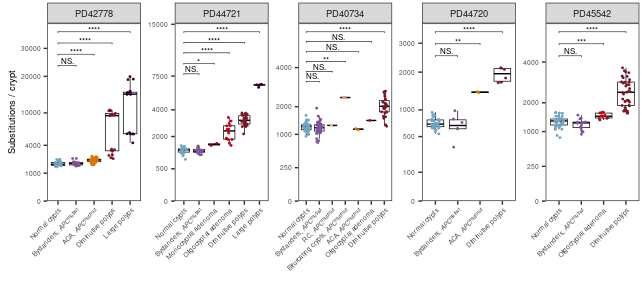
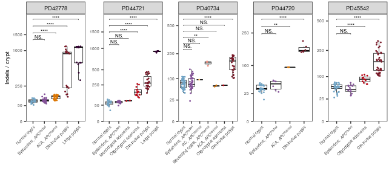
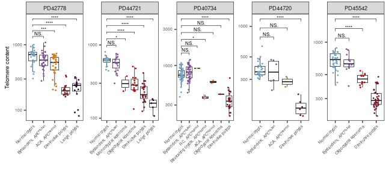
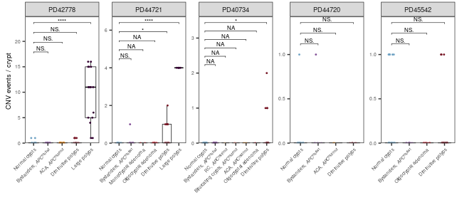
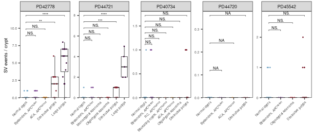
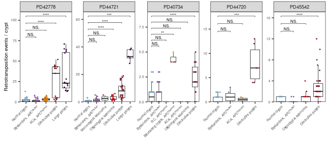
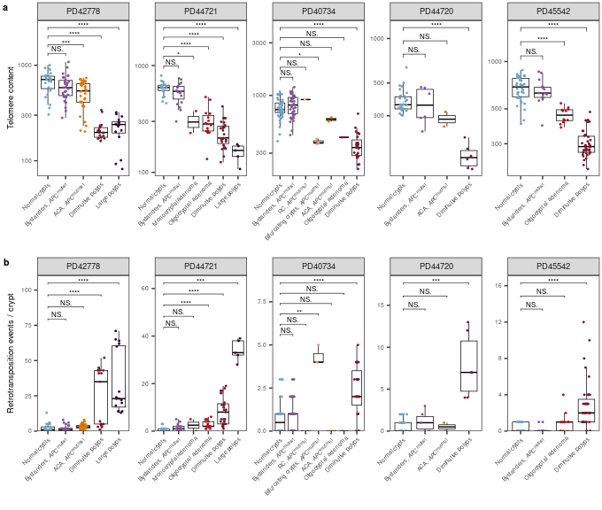

## Setup


``` r
suppressPackageStartupMessages({
  library(ggplot2)
  library(ggpubr)
  library(ggtext)
})
```


``` r
ROOT <- "/lustre/scratch125/casm/teams/team267/users/yw2/colon/github_repo"

OUT_DIR <- file.path(ROOT, "Fig2_Mutation_burden")
dir.create(OUT_DIR, showWarnings = FALSE, recursive = TRUE)

# Telomere content and retrotransposition go to the supplement rather than Fig 2.
SUPP_DIR <- file.path(dirname(ROOT), "supp_figures")
dir.create(SUPP_DIR, showWarnings = FALSE, recursive = TRUE)

# Nature style for the supplementary figure: 180 mm two-column width, the two
# box-plot rows stacked.
SUPP_W <- 180 / 25.4
SUPP_H <- 6

FAP_CSV <- file.path(ROOT, "data/fap_database_withexposure.csv")
CNV_CSV <- file.path(ROOT, "data/CNV_SV_RT/CNV.csv")
SV_CSV  <- file.path(ROOT, "data/CNV_SV_RT/SV.csv")

driver_cols <- c("germlinehit", "somatic1", "somatic2")

type_levels <- c("Normal crypts", "Bystander crypts",
                 "Normal crypts, APC mut/mut", "RC", "Bifurcating crypts", "ACA",
                 "Monocryptal adenoma", "Oligocryptal adenoma",
                 "Diminutive polyps", "Large polyps")

type_labels_html <- c(
  "Normal crypts"              = "Normal crypts",
  "Normal crypts, APC mut/mut" = "Normal crypts, <i>APC</i><sup>mut/mut</sup>",
  "Bystander crypts"           = "Bystanders, <i>APC</i><sup>mut/wt</sup>",
  "Bifurcating crypts"         = "Bifurcating crypts, <i>APC</i><sup>mut/mut</sup>",
  "RC"                         = "RC, <i>APC</i><sup>mut/mut</sup>",
  "ACA"                        = "ACA, <i>APC</i><sup>mut/mut</sup>",
  "Monocryptal adenoma"        = "Monocryptal adenoma",
  "Oligocryptal adenoma"       = "Oligocryptal adenoma",
  "Diminutive polyps"          = "Diminutive polyps",
  "Large polyps"               = "Large polyps"
)

patients <- c("PD42778", "PD44721", "PD40734", "PD44720", "PD45542")

# Crypt-type palette shared with Fig 3 and the supp age dotplots: blue/purple
# for APC-wt-at-second-hit crypts, then one warm ladder that darkens along
# lesion progression. Colour duplicates the x axis, so no legend is drawn.
type_cols <- c(
  "Normal crypts"              = "#70A3C4",
  "Bystander crypts"           = "#835198",
  "Normal crypts, APC mut/mut" = "#faea89",
  "RC"                         = "#fec07d",
  "Bifurcating crypts"         = "#f09080",
  "ACA"                        = "#dd7601",
  "Monocryptal adenoma"        = "#bb0414",
  "Oligocryptal adenoma"       = "#bb0414",
  "Diminutive polyps"          = "#781827",
  "Large polyps"               = "#320030"
)

# APC gene body on hg38, used to exclude the driver lesion from CNV/SV counts.
APC_CHR <- "chr5"; APC_START <- 112737819; APC_END <- 112846239

# Nature style: each figure spans the full two-column width (180 mm), with all
# fonts inside the 5-7 pt print range.
FIG_W <- 170 / 25.4
FIG_H <- 3

FS_AXIS_TEXT  <- 5      # rotated category labels and y tick labels
FS_AXIS_TITLE <- 7
FS_STRIP      <- 7      # patient facet headers
FS_LEGEND     <- 6
FS_LEGEND_TIT <- 7
PT_SIZE       <- 0.35   # jitter point size, scaled down with the figure
# ggplot resolves jitter when a plot is DRAWN, not when it is built, so an
# unseeded geom_jitter scatters the points afresh on every print(): the PDFs
# were not reproducible run to run, and the Telomere/RT panels reused in the
# supplementary figure did not match their own standalone PDFs. Seeding the
# position makes every draw of a layer identical, wherever it is drawn.
JITTER_SEED   <- 42
STAR_SIZE     <- 6 / .pt  # bracket labels at 6 pt (geom_text size is in mm)
```

## Load and classify


``` r
database <- read.csv(FAP_CSV, header = TRUE, stringsAsFactors = FALSE)

database$num_drivers <- rowSums(!is.na(database[, driver_cols]) &
                                database[, driver_cols] != "")

df <- database[!is.na(database$coverage) & database$coverage > 10, ]
```


``` r
classify_type <- function(type, num_drivers, trapped_in_polyp) {
  trapped <- !is.na(trapped_in_polyp) & trapped_in_polyp != ""
  out <- rep(NA_character_, length(type))
  out[type == "normal" & num_drivers >= 2] <- "Normal crypts, APC mut/mut"
  out[type == "normal" & num_drivers <  2 &  trapped] <- "Bystander crypts"
  out[type == "normal" & num_drivers <  2 & !trapped] <- "Normal crypts"
  out[type == "bc"  & num_drivers >= 2] <- "Bifurcating crypts"
  out[type == "bc"  & num_drivers <  2] <- "Bystander crypts"
  out[type == "aca" & num_drivers >= 2] <- "ACA"
  out[type == "aca" & num_drivers <  2] <- "Bystander crypts"
  out[type == "rc"  & num_drivers >= 2] <- "RC"
  out[type == "rc"  & num_drivers <  2] <- "Bystander crypts"
  out[type == "trapped_crypt" & num_drivers <  2] <- "Bystander crypts"
  out[type == "monocryptal_adenoma"]  <- "Monocryptal adenoma"
  out[type == "oligocryptal_adenoma"] <- "Oligocryptal adenoma"
  out[type == "diminutive_polyp"] <- "Diminutive polyps"
  out[type == "large_polyp"] <- "Large polyps"
  out
}

df$plot_type <- classify_type(df$type, df$num_drivers, df$trapped_in_polyp)
df <- df[!is.na(df$plot_type), ]
df$plot_type <- factor(df$plot_type,
                       levels = type_levels[type_levels %in% unique(df$plot_type)])

df <- df[df$patient %in% patients, ]
df$patient <- factor(df$patient, levels = patients)
```

## CNV / SV counts excluding the APC driver lesion

``` r
fap_meta <- database[, c("sample", "group_id")]
group_of_sample <- setNames(fap_meta$group_id, fap_meta$sample)

DRIVER_GAP <- 1e6   # gap tolerated when reconstructing the driver segment

# Per lineage, rebuild the chr5 driver interval: seed it with the segments that
# overlap APC, then grow it over segments lying within DRIVER_GAP of it. This
# removes the initiating APC event together with the pieces it gets split into. 
apc_driver_flags <- function(seg_start, seg_end, group_id, seed) {
  drop <- rep(FALSE, length(seg_start))
  for (g in unique(group_id[!is.na(group_id)])) {
    idx <- which(group_id == g & !is.na(seg_start))
    if (!length(idx) || !any(seed[idx])) next
    s <- seg_start[idx]; e <- seg_end[idx]
    lo <- min(s[seed[idx]]); hi <- max(e[seed[idx]])
    repeat {
      near <- s <= hi + DRIVER_GAP & e >= lo - DRIVER_GAP
      nlo <- min(lo, min(s[near])); nhi <- max(hi, max(e[near]))
      if (nlo == lo && nhi == hi) break
      lo <- nlo; hi <- nhi
    }
    drop[idx[s <= hi + DRIVER_GAP & e >= lo - DRIVER_GAP]] <- TRUE
  }
  drop
}

drop_apc_cnv <- function(ev) {
  on5 <- ev$chr == APC_CHR
  seed <- on5 & ev$start <= APC_END & ev$end >= APC_START
  drop <- rep(FALSE, nrow(ev))
  drop[on5] <- apc_driver_flags(ev$start[on5], ev$end[on5], ev$group_id[on5], seed[on5])
  ev[!drop, ]
}

drop_apc_sv <- function(ev) {
  on5 <- ev$chrom1 == APC_CHR | ev$chrom2 == APC_CHR
  s1 <- ifelse(ev$chrom1 == APC_CHR, ev$pos1_start, NA_real_)
  e1 <- ifelse(ev$chrom1 == APC_CHR, ev$pos1_end,   NA_real_)
  s2 <- ifelse(ev$chrom2 == APC_CHR, ev$pos2_start, NA_real_)
  e2 <- ifelse(ev$chrom2 == APC_CHR, ev$pos2_end,   NA_real_)
  seg_s <- suppressWarnings(pmin(s1, s2, na.rm = TRUE))
  seg_e <- suppressWarnings(pmax(e1, e2, na.rm = TRUE))
  seed <- (ev$chrom1 == APC_CHR & ev$pos1_start <= APC_END & ev$pos1_end >= APC_START) |
          (ev$chrom2 == APC_CHR & ev$pos2_start <= APC_END & ev$pos2_end >= APC_START) |
          # both breakpoints on chr5 FLANKING APC: the gene lies between them
          (ev$chrom1 == APC_CHR & ev$chrom2 == APC_CHR &
           seg_s <= APC_START & seg_e >= APC_END)
  seed[is.na(seed)] <- FALSE
  drop <- rep(FALSE, nrow(ev))
  drop[on5] <- apc_driver_flags(seg_s[on5], seg_e[on5], ev$group_id[on5], seed[on5])
  ev[!drop, ]
}

cnv_events <- read.csv(CNV_CSV, header = TRUE, stringsAsFactors = FALSE)
cnv_events$group_id <- group_of_sample[cnv_events$sample]
cnv_events <- drop_apc_cnv(cnv_events)
cnv_noapc_counts <- table(cnv_events$sample)

sv_events <- read.csv(SV_CSV, header = TRUE, stringsAsFactors = FALSE)
sv_events$group_id <- group_of_sample[sv_events$sample]
sv_events <- drop_apc_sv(sv_events)
sv_noapc_counts <- table(sv_events$sample)

# samples with no remaining non-APC events after filtering should also read 0, not NA.
m_cnv <- match(df$sample, names(cnv_noapc_counts))
df$CNV_noAPC <- ifelse(is.na(m_cnv), 0L, as.integer(cnv_noapc_counts[m_cnv]))
m_sv <- match(df$sample, names(sv_noapc_counts))
df$SV_noAPC <- ifelse(is.na(m_sv), 0L, as.integer(sv_noapc_counts[m_sv]))
```

## Pairwise tests, BH-corrected across the whole family


``` r
# Square-root y axis for the SBS and indel burdens, as in Fig 3b,c: it
# stretches the low range so the early-lesion shifts are visible next to polyps.
# Breaks are thinned on the sqrt scale so they do not bunch up at the top.
SQRT_BREAK_CAND <- c(0, 25, 50, 100, 250, 500, 1000, 1500, 2000, 2500, 3000,
                     4000, 5000, 7500, 10000, 15000, 20000, 30000)
sqrt_breaks <- function(lim, min_sep = 0.14) {
  cand <- SQRT_BREAK_CAND[SQRT_BREAK_CAND <= lim[2]]
  keep <- cand[1]
  for (v in cand[-1])
    if (sqrt(v) - sqrt(keep[length(keep)]) >= min_sep * sqrt(lim[2])) keep <- c(keep, v)
  keep
}

BOX_VARS <- list(
  SBS      = list(var = "sbstotal_corr",   lab = "Substitutions / crypt",     log_y = FALSE, sqrt_y = TRUE),
  Indel    = list(var = "indeltotal_corr", lab = "Indels / crypt",            log_y = FALSE, sqrt_y = TRUE),
  Telomere = list(var = "telomerehunter2_tel_content",
                  lab = "Telomere content",                        log_y = TRUE),
  CNV      = list(var = "CNV_noAPC",
                  lab = "CNV events / crypt ", log_y = FALSE),
  SV       = list(var = "SV_noAPC",
                  lab = "SV events / crypt ",  log_y = FALSE),
  RT       = list(var = "RT", lab = "Retrotransposition events / crypt",  log_y = FALSE)
)

# Missing RT/CNV/SV mean "no event called",  treat as 0 
fill_na0 <- function(d, yvar) { d[[yvar]][is.na(d[[yvar]])] <- 0; d }

compute_tests <- function(d, yvar) {
  out <- list()
  for (pat in levels(d$patient)) {
    dp <- fill_na0(d[d$patient == pat, , drop = FALSE], yvar)
    present <- levels(droplevels(dp$plot_type))
    if (!("Normal crypts" %in% present) || length(present) < 2) next
    ref <- dp[[yvar]][dp$plot_type == "Normal crypts"]
    for (lv in setdiff(present, "Normal crypts")) {
      x <- dp[[yvar]][dp$plot_type == lv]
      if (!length(x) || !length(ref)) next
      pv <- suppressWarnings(stats::wilcox.test(ref, x)$p.value)
      out[[length(out) + 1]] <- data.frame(
        variable = yvar, patient = pat,
        group1 = "Normal crypts", group2 = lv,
        n_ref = length(ref), n_grp = length(x), p = pv,
        stringsAsFactors = FALSE)
    }
  }
  if (!length(out)) NULL else do.call(rbind, out)
}

box_tests <- do.call(rbind, lapply(BOX_VARS, function(v) compute_tests(df, v$var)))

# One BH family over every test in the figure and the supplementary panels:
# all crypt types, all patients and all six mutation classes. This matches
# burden_hypothesis_testing.Rmd, which corrects its ladder rows the same way.
box_tests$p_adj <- p.adjust(box_tests$p, method = "BH")

star <- function(p) ifelse(is.na(p), "NA",
                    ifelse(p < 1e-4, "****",
                    ifelse(p < 1e-3, "***",
                    ifelse(p < 1e-2, "**",
                    ifelse(p < 0.05, "*", "NS.")))))
box_tests$label <- star(box_tests$p_adj)

cat(nrow(box_tests), "Wilcoxon tests; BH applied across all comparisons",
    "(all crypt types, patients and mutation classes)\n")
```

```
## 126 Wilcoxon tests; BH applied across all comparisons (all crypt types, patients and mutation classes)
```

``` r
print(do.call(rbind, lapply(split(box_tests, box_tests$variable), function(g)
  data.frame(variable = g$variable[1], n_tests = nrow(g),
             sig_raw = sum(g$p < 0.05, na.rm = TRUE),
             sig_BH  = sum(g$p_adj < 0.05, na.rm = TRUE)))), row.names = FALSE)
```

```
##                     variable n_tests sig_raw sig_BH
##                    CNV_noAPC      21       4      4
##              indeltotal_corr      21      12     12
##                           RT      21      11      9
##                sbstotal_corr      21      13     13
##                     SV_noAPC      21       5      4
##  telomerehunter2_tel_content      21      13     12
```

``` r
write.csv(box_tests, file.path(OUT_DIR, "boxplot_wilcoxon_BH.csv"), row.names = FALSE)
```

## Plot helper


``` r
make_plot <- function(data, yvar, ylab, log_y = FALSE, sqrt_y = FALSE) {
  d <- fill_na0(data, yvar)
  p <- ggplot(d, aes(x = plot_type, y = .data[[yvar]])) +
    geom_boxplot(fill = "white", color = "black", outlier.shape = NA, linewidth = 0.25) +
    geom_point(aes(color = plot_type), alpha = 1, size = PT_SIZE,
               position = position_jitter(width = 0.2, height = 0, seed = JITTER_SEED)) +
    facet_wrap(~patient, ncol = length(patients), scales = "free") +
    theme_minimal() + theme_bw() +
    theme(text = element_text(size = FS_AXIS_TEXT),
          axis.text.x  = ggtext::element_markdown(angle = 45, hjust = 1, size = FS_AXIS_TEXT),
          axis.text.y  = element_text(size = FS_AXIS_TEXT),
          axis.title   = element_text(size = FS_AXIS_TITLE),
          strip.text   = element_text(size = FS_STRIP),
          legend.text  = element_text(size = FS_LEGEND,
                                      margin = margin(l = 1, unit = "pt")),
          legend.title = element_text(size = FS_LEGEND_TIT),
          legend.key.size = unit(2.2, "mm"),
          legend.key.spacing.y = unit(0.5, "mm"),
          plot.margin  = margin(t = 2, r = 2, b = 2, l = 6),
          panel.grid = element_blank()) +
    labs(x = "", y = ylab) +
    scale_colour_manual(values = type_cols, guide = "none") +
    scale_x_discrete(labels = type_labels_html[levels(droplevels(d$plot_type))])

  # Brackets carry the BH-adjusted stars from box_tests. Positions are stacked
  # per facet because scales="free" gives each patient its own y range.
  tp <- box_tests[box_tests$variable == yvar, , drop = FALSE]
  if (nrow(tp) > 0) {
    tp <- do.call(rbind, lapply(split(tp, tp$patient), function(g) {
      vals <- d[[yvar]][d$patient == g$patient[1]]
      vals <- vals[is.finite(vals)]
      if (log_y) vals <- vals[vals > 0]
      top <- if (length(vals)) max(vals) else 1
      g$y.position <- if (log_y) {
        log10(top) + 0.09 * seq_len(nrow(g))
      } else if (sqrt_y) {
        # stat_pvalue_manual takes y.position on the transformed scale, as
        # the log branch above does, so stack the brackets in sqrt units
        sqrt(top) * (1 + 0.09 * seq_len(nrow(g)))
      } else {
        top + max(top - min(c(vals, 0)), 1) * 0.12 * seq_len(nrow(g))
      }
      g
    }))
    tp$patient <- factor(tp$patient, levels = levels(d$patient))
    p <- p + ggpubr::stat_pvalue_manual(tp, label = "label", tip.length = 0.01,
                                        size = STAR_SIZE, bracket.size = 0.2,
                                        inherit.aes = FALSE)
  }
  if (log_y) {
    # A log axis cannot show 0, so the telomere panel keeps its data-driven range.
    p <- p + scale_y_log10()
  } else if (sqrt_y) {
    p <- p + scale_y_continuous(trans = "sqrt", limits = c(0, NA), breaks = sqrt_breaks,
                                expand = expansion(mult = c(0, 0.05)))
  } else {
    # Counts and burdens are non-negative: anchor every panel at 0 with no lower
    # expansion so 0 sits exactly on the axis, and let the top expand to fit the
    # significance brackets.
    p <- p + scale_y_continuous(limits = c(0, NA),
                                expand = expansion(mult = c(0, 0.05)))
  }
  p
}
```

## Build the plots


``` r
plots <- lapply(BOX_VARS, function(v) make_plot(df, v$var, v$lab, v$log_y, isTRUE(v$sqrt_y)))
```


``` r
cat("n crypts per patient x plot_type (all variables combined):\n")
```

```
## n crypts per patient x plot_type (all variables combined):
```

``` r
print(table(df$patient, df$plot_type))
```

```
##          
##           Normal crypts Bystander crypts Normal crypts, APC mut/mut RC
##   PD42778            25               31                          0  0
##   PD44721            21               19                          0  0
##   PD40734            50               43                          0  1
##   PD44720            30                6                          0  0
##   PD45542            36               15                          0  0
##          
##           Bifurcating crypts ACA Monocryptal adenoma Oligocryptal adenoma
##   PD42778                  0  34                   0                    0
##   PD44721                  0   0                   2                   15
##   PD40734                  3   2                   0                    1
##   PD44720                  0   2                   0                    0
##   PD45542                  0   0                   0                   12
##          
##           Diminutive polyps Large polyps
##   PD42778                17           16
##   PD44721                27            5
##   PD40734                27            0
##   PD44720                 6            0
##   PD45542                39            0
```

## Write the PDFs


``` r
for (nm in names(plots)) {
  out_path <- file.path(OUT_DIR, paste0(nm, "_boxplot_by_patient.pdf"))
  pdf(out_path, width = FIG_W, height = FIG_H)
  print(plots[[nm]])
  invisible(dev.off())
  cat("Wrote", out_path, "\n")
}
```

```
## Wrote /lustre/scratch125/casm/teams/team267/users/yw2/colon/github_repo/Fig2_Mutation_burden/SBS_boxplot_by_patient.pdf
```

```
## Wrote /lustre/scratch125/casm/teams/team267/users/yw2/colon/github_repo/Fig2_Mutation_burden/Indel_boxplot_by_patient.pdf
```

```
## Wrote /lustre/scratch125/casm/teams/team267/users/yw2/colon/github_repo/Fig2_Mutation_burden/Telomere_boxplot_by_patient.pdf
```

```
## Wrote /lustre/scratch125/casm/teams/team267/users/yw2/colon/github_repo/Fig2_Mutation_burden/CNV_boxplot_by_patient.pdf
```

```
## Wrote /lustre/scratch125/casm/teams/team267/users/yw2/colon/github_repo/Fig2_Mutation_burden/SV_boxplot_by_patient.pdf
```

```
## Wrote /lustre/scratch125/casm/teams/team267/users/yw2/colon/github_repo/Fig2_Mutation_burden/RT_boxplot_by_patient.pdf
```


``` r
for (nm in names(plots)) {
  cat("\n\n### ", nm, "\n\n", sep = "")
  print(plots[[nm]])
}
```


### SBS

<!-- -->

### Indel

<!-- -->

### Telomere

<!-- -->

### CNV

<!-- -->

### SV

<!-- -->

### RT

<!-- -->

## Supplementary figure: telomere content and retrotransposition


``` r
# The two panels are the ones written above, stacked and labelled a, b.
supp_panel <- ggarrange(plots[["Telomere"]], plots[["RT"]],
                        ncol = 1, nrow = 2, align = "v",
                        labels = c("a", "b"),
                        font.label = list(size = 8, face = "bold"))

supp_out <- file.path(SUPP_DIR, "SuppFig_telomere_RT_boxplot.pdf")
pdf(supp_out, width = SUPP_W, height = SUPP_H)
print(supp_panel)
invisible(dev.off())
cat("Wrote", supp_out, sprintf("(%.0f x %.0f mm)\n", SUPP_W * 25.4, SUPP_H * 25.4))
```

```
## Wrote /lustre/scratch125/casm/teams/team267/users/yw2/colon/supp_figures/SuppFig_telomere_RT_boxplot.pdf (180 x 152 mm)
```

``` r
supp_panel
```

<!-- -->
