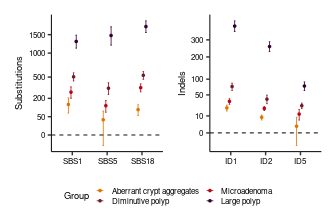
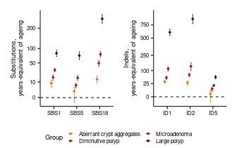

## Setup


``` r
suppressPackageStartupMessages({
  library(ggplot2)
  library(nlme)
  library(ggpubr)
  library(patchwork)
  library(cowplot)
})
```


``` r
ROOT <- "/lustre/scratch125/casm/teams/team267/users/yw2/colon/github_repo"

OUT_DIR <- file.path(ROOT, "Fig3_Signature_analysis")
dir.create(OUT_DIR, showWarnings = FALSE, recursive = TRUE)

FAP_CSV  <- file.path(ROOT, "data/fap_database_withexposure.csv")

# Lesion stages in order of progression. Each stage's effect is estimated in a
# model containing normal crypts and every earlier stage.
LADDER <- c("normal", "aca", "microadenoma",
            "diminutive_polyp", "large_polyp")
STAGE_LABELS <- c(aca              = "Aberrant crypt aggregates",
                  microadenoma     = "Microadenoma",
                  diminutive_polyp = "Diminutive polyp",
                  large_polyp      = "Large polyp")

# it separates independent APC-mutant lineages within a lesion.
LADDER_RANDOM <- ~1 | patient/block/subgroup_id
# The age slope is fitted on normal crypts only, which have no lesion structure.
NORMAL_RANDOM <- ~1 | patient/block

# "Age effect" rows hold each signature's per-year rate in normal crypts;
# the stage rows hold the excess burden.
STAGE_NAMES <- unname(STAGE_LABELS[LADDER[-1]])
ROW_LEVELS  <- c("Age effect", STAGE_NAMES)
stage_cols  <- c("black", "#dd7601", "#bb0414", "#781827", "#320030")
names(stage_cols) <- ROW_LEVELS

# Nature style: each figure is a single column (89 mm), fonts in the 5-7 pt
# range. The substitution and indel panels sit side by side in one row and share
# the 89 mm together; the legend sits underneath both.
FIG_W <- 89 / 25.4
FIG_H <- 2.2

FS_AXIS_TITLE <- 7
FS_AXIS_TEXT  <- 6
FS_LEGEND     <- 6
FS_LEGEND_TIT <- 7
PT_SIZE       <- 0.6   # estimate points
LINE_W        <- 0.35  # axis lines and the zero rule
ERR_W         <- 0.28  # error bar strokes
CAP_W         <- 0.18  # error bar cap width, in category units
```

## Build the modelling dataset


``` r
database <- read.csv(FAP_CSV, header = TRUE, stringsAsFactors = FALSE,
                       na.strings = c("", "NA"))
# monocryptal and oligocryptal adenomas are analysed together as microadenomas
database$type[database$type %in% c("monocryptal_adenoma", "oligocryptal_adenoma")] <- "microadenoma"

# germline + somatic APC hits: 1 = APC mut/wt, >=2 = second hit present
database$n_apc_hits <- as.numeric(3 - (is.na(database$germlinehit) +
                                        is.na(database$somatic1) +
                                        is.na(database$somatic2)))
database <- database[database$coverage > 10, ]

# Ladder stage of each crypt: all normal crypts, and lesion crypts carrying a
# second APC hit. 
database$stage <- NA_character_
database$stage[database$type == "normal"] <- "normal"
for (stage in setdiff(LADDER, "normal"))
  database$stage[database$type == stage & database$n_apc_hits >= 2] <- stage

ladder_crypts <- database[!is.na(database$stage), ]
ladder_crypts$type <- factor(ladder_crypts$stage, levels = LADDER)

# Each normal crypt is their own group
is_normal <- ladder_crypts$type == "normal"
ladder_crypts$group_id[is_normal]    <- ladder_crypts$sample[is_normal]
ladder_crypts$subgroup_id[is_normal] <- ladder_crypts$sample[is_normal]
```


``` r
cat("n crypts per ladder category (num_APC>=2, or normal):\n")
```

```
## n crypts per ladder category (num_APC>=2, or normal):
```

``` r
print(table(ladder_crypts$type))
```

```
## 
##           normal              aca     microadenoma diminutive_polyp 
##              192               38               30              112 
##      large_polyp 
##               21
```

## Model fits


``` r
# Excess burden of LADDER[stage_index] over normal crypts at the same age, from
# sig ~ age + type fitted on normal crypts and every stage up to this one.
fit_stage_effect <- function(sig, stage_index) {
  stages_in_model <- LADDER[1:stage_index]
  fit_data <- ladder_crypts[ladder_crypts$type %in% stages_in_model, ]
  fit_data$type <- factor(fit_data$type, levels = stages_in_model)
  fit <- lme(as.formula(paste0(sig, " ~ age + type")),
             random = LADDER_RANDOM, data = fit_data, method = "REML")
  ci <- intervals(fit, which = "fixed")[["fixed"]]
  coef_name <- paste0("type", LADDER[stage_index])
  list(est = ci[coef_name, "est."], lower = ci[coef_name, "lower"], upper = ci[coef_name, "upper"])
}

# Per-year accumulation of the signature in normal crypts.
fit_age_rate <- function(sig) {
  fit_data <- ladder_crypts[ladder_crypts$type == "normal", ]
  fit <- lme(as.formula(paste0(sig, " ~ age")),
             random = NORMAL_RANDOM, data = fit_data, method = "REML")
  ci <- intervals(fit, which = "fixed")[["fixed"]]
  list(est = ci["age", "est."], lower = ci["age", "lower"], upper = ci["age", "upper"])
}

# One row per signature x (age rate, each stage). Column names are those of the
# exported disease_effect_estimates.csv: `type` is the signature, `group` the
# row kind ("Age effect" or a stage label), `rate` the estimate.
build_effect_table <- function(sigs) {
  rows <- list()
  for (sig in sigs) {
    age_rate <- fit_age_rate(sig)
    rows[[length(rows) + 1]] <- data.frame(rate = age_rate$est, type = sig, group = "Age effect",
                                           lower_95_CI = age_rate$lower, upper_95_CI = age_rate$upper)
    for (k in 2:length(LADDER)) {
      effect <- fit_stage_effect(sig, k)
      rows[[length(rows) + 1]] <- data.frame(rate = effect$est, type = sig,
                                             group = STAGE_LABELS[[LADDER[k]]],
                                             lower_95_CI = effect$lower, upper_95_CI = effect$upper)
    }
  }
  out <- do.call(rbind, rows)
  # Keep the unrounded estimates (*_raw) for the years-equivalent ratio; the
  # rounded columns are for display.
  for (col in c("rate", "lower_95_CI", "upper_95_CI")) {
    out[[paste0(col, "_raw")]] <- as.numeric(out[[col]])
    out[[col]] <- round(as.numeric(out[[col]]), 2)
  }
  out
}

sbs_effects <- build_effect_table(c("SBS18", "SBS1", "SBS5"))
id_effects  <- build_effect_table(c("ID1", "ID2", "ID5"))

sbs_effects$group <- factor(sbs_effects$group, levels = ROW_LEVELS)
id_effects$group  <- factor(id_effects$group,  levels = ROW_LEVELS)
sbs_effects$type  <- factor(sbs_effects$type,  levels = c("SBS1", "SBS5", "SBS18"))
id_effects$type   <- factor(id_effects$type,   levels = c("ID1", "ID2", "ID5"))
```

## Disease effect


``` r
# Point estimate and 95% CI per signature, one colour per stage.
effect_plot <- function(effects, ylab, est_col, lo_col, hi_col) {
  ggplot(effects, aes(x = type, y = .data[[est_col]], group = group, color = group)) +
    geom_point(position = position_dodge(width = 0.3), size = PT_SIZE) +
    geom_errorbar(aes(ymin = .data[[lo_col]], ymax = .data[[hi_col]]), width = CAP_W,
                  linewidth = ERR_W, position = position_dodge(width = 0.3)) +
    # fixed keys, so the legend is the same whichever panel it is taken from
    scale_color_manual(values = stage_cols, name = "Group",
                       limits = STAGE_NAMES, drop = FALSE) +
    # Two rows: at 89 mm a single row of four keys plus the title overruns the
    # panel and is clipped at both ends.
    guides(colour = guide_legend(nrow = 2, byrow = TRUE)) +
    theme_bw() +
    theme(panel.grid = element_blank(), panel.border = element_blank(),
          axis.line = element_line(colour = "black", linewidth = LINE_W)) +
    geom_hline(yintercept = 0, linetype = "dashed", color = "black",
               linewidth = LINE_W) +
    labs(y = ylab, x = NULL) +
    theme(axis.title  = element_text(size = FS_AXIS_TITLE),
          axis.text   = element_text(size = FS_AXIS_TEXT, color = "black"),
          legend.text = element_text(size = FS_LEGEND),
          legend.title = element_text(size = FS_LEGEND_TIT),
          legend.key.size = unit(2.2, "mm"),
          legend.key.spacing.y = unit(0.5, "mm"))
}

# Signed square-root y axis: compresses the large polyp estimates while keeping
# negative CI bounds below the zero rule.
signed_sqrt_trans <- scales::trans_new(
  "signed_sqrt",
  transform = function(x) sign(x) * sqrt(abs(x)),
  inverse   = function(x) sign(x) * x^2)

# Labels are non-negative only; the whiskers still run below the zero rule where they should.
# Candidates are thinned on the SQRT scale, so they do not bunch up low down.
SQRT_BREAK_CAND <- c(0, 5, 10, 25, 50, 100, 150, 200, 250, 300, 400, 500,
                     750, 1000, 1500, 2000, 3000, 5000)
sqrt_breaks <- function(y_max, min_sep = 0.14) {
  candidates <- SQRT_BREAK_CAND[SQRT_BREAK_CAND <= y_max]
  breaks <- candidates[1]
  for (v in candidates[-1])
    if (sqrt(v) - sqrt(breaks[length(breaks)]) >= min_sep * sqrt(y_max)) breaks <- c(breaks, v)
  breaks
}

sqrt_panel <- function(effects, ylab, est_col, lo_col, hi_col) {
  effect_plot(effects, ylab, est_col, lo_col, hi_col) +
    scale_y_continuous(trans = signed_sqrt_trans, breaks = sqrt_breaks(max(effects[[hi_col]])))
}

# Substitutions and indels side by side in one row, the pair spanning a single
# 89 mm column, with the legend drawn once underneath.
LEGEND_HEIGHT_FRAC <- 0.17   # share of figure height given to the legend strip

shared_legend <- function(effects, est_col, lo_col, hi_col) {
  ggpubr::get_legend(effect_plot(effects, NULL, est_col, lo_col, hi_col) +
                       theme(legend.position = "bottom"))
}

assemble_figure <- function(sbs_panel, id_panel, legend) {
  panels <- (sbs_panel | id_panel) & theme(legend.position = "none")
  cowplot::plot_grid(panels, legend, ncol = 1, rel_heights = c(1, LEGEND_HEIGHT_FRAC))
}

sbs_stage_effects <- sbs_effects[sbs_effects$group != "Age effect", ]
id_stage_effects  <- id_effects[id_effects$group != "Age effect", ]
excess_burden_plot <- assemble_figure(
  sqrt_panel(sbs_stage_effects, "Substitutions", "rate", "lower_95_CI", "upper_95_CI"),
  sqrt_panel(id_stage_effects,  "Indels",        "rate", "lower_95_CI", "upper_95_CI"),
  shared_legend(sbs_stage_effects, "rate", "lower_95_CI", "upper_95_CI"))
excess_burden_plot
```

<!-- -->

## Years-of-ageing equivalent

Estimate/CI divided by that signature's own age-effect slope
(mutations per year) -- how many years of normal ageing that stage's added burden
is equivalent to.


``` r
# Stage rows with the excess burden divided by the signature's age rate.
add_years_equivalent <- function(effects) {
  # divide unrounded by unrounded; the rounded columns are for display only
  is_age_row <- effects$group == "Age effect"
  age_rate_by_sig <- setNames(effects$rate_raw[is_age_row], effects$type[is_age_row])
  stage_rows <- effects[!is_age_row, ]
  age_rate <- age_rate_by_sig[as.character(stage_rows$type)]
  stage_rows$age_rate    <- as.numeric(age_rate)   # denominator, carried so the ratio is readable
  stage_rows$ratio_est   <- stage_rows$rate_raw / age_rate
  stage_rows$ratio_lower <- stage_rows$lower_95_CI_raw / age_rate
  stage_rows$ratio_upper <- stage_rows$upper_95_CI_raw / age_rate
  stage_rows
}

sbs_years <- add_years_equivalent(sbs_effects)
id_years  <- add_years_equivalent(id_effects)

years_plot <- assemble_figure(
  sqrt_panel(sbs_years, "Substitutions,\nyears-equivalent of ageing",
             "ratio_est", "ratio_lower", "ratio_upper"),
  sqrt_panel(id_years,  "Indels,\nyears-equivalent of ageing",
             "ratio_est", "ratio_lower", "ratio_upper"),
  shared_legend(sbs_years, "ratio_est", "ratio_lower", "ratio_upper"))
years_plot
```

<!-- -->


``` r
figures <- list("disease_effect"                  = excess_burden_plot,
                "disease_effect_years_equivalent" = years_plot)
for (name in names(figures)) {
  out_pdf <- file.path(OUT_DIR, paste0(name, ".pdf"))
  pdf(out_pdf, width = FIG_W, height = FIG_H)
  print(figures[[name]])
  invisible(dev.off())
}
```

## Tables

`years_equivalent` is the excess burden of that signature in that lesion divided
by the rate at which the **same** signature accumulates with age in normal
crypts.


``` r
years_tab <- rbind(cbind(sbs_years, variable_group = "SBS"),
                   cbind(id_years,  variable_group = "Indel"))
# rename to the exported column names
names(years_tab)[match(c("rate","age_rate","ratio_est","ratio_lower","ratio_upper","type"),
                       names(years_tab))] <-
  c("excess_per_crypt","age_rate_per_year","years_equivalent",
    "years_lower_95_CI","years_upper_95_CI","signature")
years_tab$group <- factor(years_tab$group, levels = STAGE_NAMES)
years_tab <- years_tab[order(years_tab$group, -years_tab$years_equivalent), ]
years_tab$rank_within_stage <- ave(-years_tab$years_equivalent, years_tab$group,
                                   FUN = function(x) rank(x, ties.method = "first"))
years_tab$ci_excludes_zero <- years_tab$years_lower_95_CI > 0
years_tab <- years_tab[, c("group","rank_within_stage","signature","variable_group",
                           "excess_per_crypt","age_rate_per_year","years_equivalent",
                           "years_lower_95_CI","years_upper_95_CI","ci_excludes_zero")]

write.csv(years_tab, file.path(OUT_DIR, "disease_effect_years_equivalent.csv"), row.names = FALSE)
write.csv(rbind(cbind(sbs_effects, variable_group = "SBS"),
                cbind(id_effects,  variable_group = "Indel")),
          file.path(OUT_DIR, "disease_effect_estimates.csv"), row.names = FALSE)

knitr::kable(years_tab, digits = 3, row.names = FALSE,
             caption = "Years-equivalent, ranked within each lesion stage")
```


Table: Years-equivalent, ranked within each lesion stage

|group                     | rank_within_stage|signature |variable_group | excess_per_crypt| age_rate_per_year| years_equivalent| years_lower_95_CI| years_upper_95_CI|ci_excludes_zero |
|:-------------------------|-----------------:|:---------|:--------------|----------------:|-----------------:|----------------:|-----------------:|-----------------:|:----------------|
|Aberrant crypt aggregates |                 1|ID1       |Indel          |            21.64|             0.655|           33.034|            25.166|            40.902|TRUE             |
|Aberrant crypt aggregates |                 2|ID2       |Indel          |             8.43|             0.294|           28.686|            19.636|            37.736|TRUE             |
|Aberrant crypt aggregates |                 3|SBS18     |SBS            |            95.84|             6.796|           14.102|             8.192|            20.012|TRUE             |
|Aberrant crypt aggregates |                 4|SBS1      |SBS            |           138.77|            16.009|            8.669|             4.463|            12.874|TRUE             |
|Aberrant crypt aggregates |                 5|SBS5      |SBS            |            34.54|            20.102|            1.718|            -0.806|             4.242|FALSE            |
|Aberrant crypt aggregates |                 6|ID5       |Indel          |             1.54|             1.365|            1.130|            -3.983|             6.244|FALSE            |
|Microadenoma              |                 1|ID2       |Indel          |            20.66|             0.294|           70.332|            58.571|            82.093|TRUE             |
|Microadenoma              |                 2|ID1       |Indel          |            34.43|             0.655|           52.573|            43.403|            61.743|TRUE             |
|Microadenoma              |                 3|SBS18     |SBS            |           333.28|             6.796|           49.041|            40.733|            57.349|TRUE             |
|Microadenoma              |                 4|SBS1      |SBS            |           273.22|            16.009|           17.067|            12.563|            21.572|TRUE             |
|Microadenoma              |                 5|ID5       |Indel          |            12.23|             1.365|            8.961|             4.178|            13.744|TRUE             |
|Microadenoma              |                 6|SBS5      |SBS            |           127.76|            20.102|            6.355|             3.846|             8.865|TRUE             |
|Diminutive polyp          |                 1|ID2       |Indel          |            39.45|             0.294|          134.275|           100.526|           168.023|TRUE             |
|Diminutive polyp          |                 2|ID1       |Indel          |            74.47|             0.655|          113.702|            95.909|           131.495|TRUE             |
|Diminutive polyp          |                 3|SBS18     |SBS            |           530.94|             6.796|           78.127|            68.033|            88.220|TRUE             |
|Diminutive polyp          |                 4|SBS1      |SBS            |           504.92|            16.009|           31.541|            27.157|            35.924|TRUE             |
|Diminutive polyp          |                 5|ID5       |Indel          |            25.61|             1.365|           18.761|            14.948|            22.574|TRUE             |
|Diminutive polyp          |                 6|SBS5      |SBS            |           325.81|            20.102|           16.207|            12.162|            20.253|TRUE             |
|Large polyp               |                 1|ID2       |Indel          |           258.50|             0.294|          879.904|           779.969|           979.839|TRUE             |
|Large polyp               |                 2|ID1       |Indel          |           395.45|             0.655|          603.797|           543.000|           664.593|TRUE             |
|Large polyp               |                 3|SBS18     |SBS            |          1751.86|             6.796|          257.781|           229.816|           285.745|TRUE             |
|Large polyp               |                 4|SBS1      |SBS            |          1304.78|            16.009|           81.506|            70.226|            92.785|TRUE             |
|Large polyp               |                 5|SBS5      |SBS            |          1474.65|            20.102|           73.357|            59.884|            86.829|TRUE             |
|Large polyp               |                 6|ID5       |Indel          |            76.16|             1.365|           55.803|            45.717|            65.889|TRUE             |
